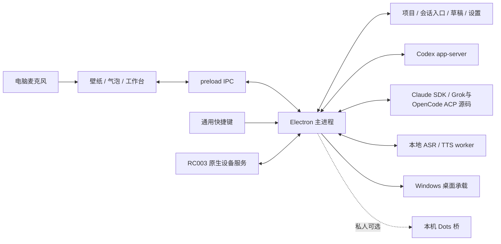

# 架构与技术路线

## 当前技术选择

主应用为 Electron 44.7.2、Node.js 24+、原生 JavaScript、esbuild；渲染使用 PixiJS 8.20.0 和 pixi-live2d-display 1.4.0。版本来自[应用依赖清单](../../prototypes/live2d-codex/package.json)与 lockfile，不表示永远不升级。

Agent 通过 Windows 原生 CLI 的结构化接口接入：Codex 为 app-server RPC；Claude 源码使用 Claude Agent SDK；Grok/OpenCode 源码使用 ACP。后两类 SDK 已锁定依赖，但真实桌面验收尚未完成。语音使用 sherpa-onnx CPU worker 承载 SenseVoice/Kokoro，Qwen 使用独立 Python/GPU worker。RC003 生产服务使用 C# Raw Input/Windows BLE，主进程 JavaScript 解码 ATVV；旧 Python 诊断独立保留。

早期 C#/.NET/WPF 主界面、SQLite 和双 Whisper 候选是历史路线；当前 C# 只用于 Windows 辅助和设备探针。不要按旧示例 schema 修改现行应用数据。

## 系统关系

实线表示已有连接，不表示所有失败路径已验证；虚线表示尚未产品化或私人可选。当前一个活动后端承载一个选中会话；多个项目和历史会话不等于多个并行执行的后台任务。

## 模块及修改入口

| 模块 | 主要位置 | 责任 |
| --- | --- | --- |
| 应用协调 | [main.cjs](../../prototypes/live2d-codex/main.cjs) | 窗口、后端选择、IPC 校验、捕获目标、生命周期与退出 |
| 页面能力边界 | [preload.cjs](../../prototypes/live2d-codex/preload.cjs) | 暴露有限 companion 方法，转发状态事件 |
| 气泡与录音 | [app.js](../../prototypes/live2d-codex/renderer/app.js) | 草稿交互、采集、当前回复、朗读触发与窗口操作 |
| 项目工作台 | [workbench.js](../../prototypes/live2d-codex/renderer/workbench.js) | 项目/会话选择、设置和资源管理 |
| 草稿及回复语义 | [draft-session.mjs](../../prototypes/live2d-codex/renderer/draft-session.mjs)、[current-reply.mjs](../../prototypes/live2d-codex/renderer/current-reply.mjs) | 目标、修订与当前可见回复的边界 |
| Codex | [codex.mjs](../../prototypes/live2d-codex/backend/codex.mjs)、[rpc.mjs](../../prototypes/live2d-codex/backend/rpc.mjs) | CLI 查找、连接、会话/轮次、权限、模型、恢复、中断 |
| 新 Agent 共用状态 | [native-agent.mjs](../../prototypes/live2d-codex/backend/native-agent.mjs) | 状态、消息缓存、会话保存和完成事件 |
| 新协议适配 | [claude-agent.mjs](../../prototypes/live2d-codex/backend/claude-agent.mjs)、[acp-agent.mjs](../../prototypes/live2d-codex/backend/acp-agent.mjs) | SDK/ACP 差异、审批与问题、原生进程 |
| 本地索引 | [workspace-store.mjs](../../prototypes/live2d-codex/backend/workspace-store.mjs) | 项目、草稿、设置、provider 与路径归一化 |
| 发送保护 | [submission-guard.mjs](../../prototypes/live2d-codex/backend/submission-guard.mjs) | 发送前保存原稿；未知结果持久化；原生历史核查；禁止自动重发 |
| 数据提交与恢复 | [durable-json.mjs](../../prototypes/live2d-codex/backend/durable-json.mjs)、[data-directory.mjs](../../prototypes/live2d-codex/backend/data-directory.mjs)、[data-recovery.mjs](../../prototypes/live2d-codex/backend/data-recovery.mjs) | 提交后更新内存、上一版本备份、目录验证与只写新副本的恢复 |
| 语音生命周期 | [resident-speech.mjs](../../prototypes/live2d-codex/backend/resident-speech.mjs)、[speech.mjs](../../prototypes/live2d-codex/backend/speech.mjs) | ASR/TTS 驻留、合成、停止与资源释放 |
| 模型与运行时 | [voice-resources.mjs](../../prototypes/live2d-codex/backend/voice-resources.mjs)、[voice-runtime.mjs](../../prototypes/live2d-codex/backend/voice-runtime.mjs) | 下载、哈希、取消续传、隔离环境准备 |
| 桌面及输入 | [wallpaper-host.cjs](../../prototypes/live2d-codex/backend/wallpaper-host.cjs)、[input-actions.cjs](../../prototypes/live2d-codex/backend/input-actions.cjs) | 桌面层承载、快捷键注册/冲突/挂起 |
| RC003 主应用服务 | [接入说明](remote-integration.md) | 原生连接、按键、内置麦克风、状态/按钮配置、目标草稿；独立探针保留为诊断 |

## 领域对象与状态

- **Project**：本地项目入口和路径。路径有效性、别名与规范化由存储模块处理，不通过显示名称辨认目标。
- **Provider**：Codex、Claude、Grok、OpenCode 或本机 Dots。provider 是草稿、历史和会话选择的一部分。
- **Thread/session**：原生 Agent 的稳定会话 ID；不是 OS 窗口、进程 ID 或 Git 分支。
- **Turn**：一次用户请求及其回复/工具执行。中断必须定位当前会话和轮次。
- **Capture target / draft**：开始采集时的目标与可编辑草稿。目标键以 `workspace-store` 的 `draftKey` 和 renderer 的草稿逻辑为准；改字段要同时迁移持久数据和测试。
- **Resource residency**：模型是否准备/载入、是否驻留，与播放器是否正在播放分开。

连接状态、执行状态、审批/问题、发送回执、草稿修订和语音阶段分别维护。未知提交以 provider 为边界保存到工作台记录，重连不解除发送保护；核查只读原生历史。关闭代际、加载失败、存储故障及各家离线协议矩阵已有回归，范围和剩余实机工作见[本轮交付](data-agent-validation.md)。

## IPC 与协议约束

页面通过 `window.companion` 调用 `snapshot/send/interrupt/respond/chooseProvider`、项目与会话方法、`capture/transcribe/synthesize`、资源管理及窗口动作。主进程校验消息来源，只向自己的页面分发状态；页面不应直接持有 CLI 进程或账户文件。

Agent 适配器对外提供快照和状态事件，以及连接、发送、中断、恢复、模型设置、审批/问题响应和关闭等行为。Codex 与 NativeAgent 的实际实现不完全相同，不应为了文档中的统一名词伪造不存在的方法。新增后端先通过 AGT-02 契约测试，再接主界面。

`reply-completed` 需要明确对应 provider、会话、轮次和可朗读的完成文本。后端和界面共用 `reply-state.mjs` 的最终回复选择，避免多段消息与播报文本漂移；原生历史按整轮内容核对本地结果，不能证明成功的历史标记unknown，只展示、不朗读。离线契约见 FIX-03/05，真实声音与账户验收另行记录。

Codex与Native共用 `agent-lifecycle.mjs`：在异步目录/连接操作前占用操作状态，关闭使旧操作失效。Claude/ACP连接释放保留可等待的Promise，退出及重复close都等待已有释放，直到受控退出流程结束。语音资源激活由 `voice-activation.mjs` 接受应用拥有的服务与关闭状态，便于直接验证退出边界。

## 数据与进程所有权

源码默认数据在 `work/runtime/avatar`；安装版在 `%LOCALAPPDATA%/VibeVoice` 或用户选择的已有目录。`workspaces.json` 等使用序列化写入和临时文件替换，CLI 自己维护其账户和完整历史。新 Agent 另有应用侧消息缓存。详见[数据与发布](data-and-release.md)。

测试包由 `portable.json.testBuild.id` 选择独立默认数据目录，目录指针也独立。主进程在任何业务数据读取前检查目录指针，原目录丢失时不回退到空目录。设置、草稿与发送记录共用事务队列；磁盘同步/替换失败时不发布该次内存修改，损坏原件不自动覆盖。

应用负责自己创建的 worker、CLI 子进程和设备连接；退出/取消不能按进程名称杀掉用户其他任务。采集/模型失败不能自动删除草稿。超时、取消、旧事件和退出并发必须在对应模块边界测试。

本机旧 Qwen 评估目录仍被源码回退逻辑和资源清单生成器引用，不能当废弃目录移动。私人 Dots 由存在性和模式选择启用，公共开发与打包不能依赖它。

## RC003 已采用路线

原生设备服务与应用控制器已接入主进程，由同一应用拥有连接和录音。连接代际与录音 ID 丢弃旧事件；音频解码有缓冲和时长上限，送入现有 SenseVoice，先保存原目标草稿再合并界面未保存的输入。遥控器设置不暴露键码；普通键盘兼容和审批保护单独处理。

源码模式按哈希编译自有 Windows 组件；打包时预编译并放入 runtime，不把诊断 GUI 或 Python 环境带给用户。接口、数据、构建及真实验收边界见 [RC003 接入说明](remote-integration.md)。
