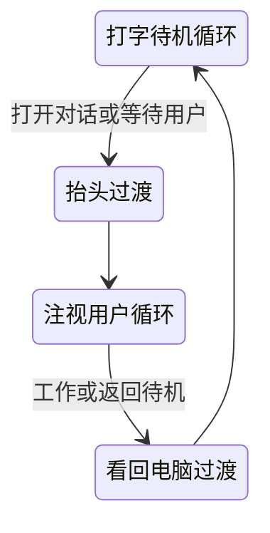

# 用现有人物复现动态视频壁纸的制作路线

> 路线变更（2026-10-22）：用户已明确放弃视频片段方案，当前方向为 [4K 静态壁纸与环境音](static-wallpaper-plan.md)。下文是此前研究/试用的历史记录，后续视频制作与验收计划已停止；已有代码和素材保留，主应用视频入口已由 ART-09 退出，当前实现见[原画恢复与第一阶段小样](static-wallpaper-preview.md)。

2026-10-22，ART-04。目标是以现有女生壁纸的脸型、双马尾、红衬衫、笔记本和雨夜场景，制作接近参考作品观感的连续动态人物。研究对象是参考作品的素材生产、动作组织与播放机制，交付物应是本项目自己的视频和播放器。

## 结论与证据分层

路线可行，关键依赖是保留人物身份的高质量短视频。播放器部分已有明确可复现的代码设计；人物素材能否达到目标，只能由实际生成片段验收。此次完成了源码拆解、三个循环视频的逐帧分析和官方生成接口核查，没有生成新人物视频，不能声称已经达到参考作品水平。

| 层次 | 已确认 | 没有被证明的部分 |
| --- | --- | --- |
| 原作者素材制作 | 项目说明自述 Seedance 2.5 生成、Topaz 放大和插帧；媒体为完整场景视频 | 下载包没有提示词、种子、生成任务、选片过程和后期工程，无法恢复原作者的完整配方 |
| 动作闭环 | 清单定义入场和待机区间；三个实际片段的待机首尾回到相近姿态 | 是否使用同图首尾约束、人工剪接或多轮生成，不能由成片反推为事实 |
| 网页播放 | 双视频预加载、精确寻址、实际帧回调后交接、失效任务取消 | 不会在网页里生成新的人物动作或修复已变形的人体 |
| 本项目适配 | 已有角色状态选择、窗口、语音、失败恢复和人物切换机制 | 视频渲染分支尚未实现，不能把已有 Live2D 验证当作新播放器验收 |

## 拆解到视频帧的结果

参考包中 `catalog.js` 为三套动态陪伴素材定义了以下 60fps 区间。结束帧按排他上界理解；播放器在上界前两帧开始交接，等待备用视频提供实际画面。

| 素材标识 | 待机起点 | 待机终点 | 一轮待机 |
| --- | --- | --- | --- |
| sit-loop-01 | 第 540 帧／9.000 秒 | 第 1350 帧／22.500 秒 | 13.500 秒 |
| sit-loop-02 | 第 524 帧／8.733 秒 | 第 1389 帧／23.150 秒 | 14.417 秒 |
| sit-loop-03 | 第 480 帧／8.000 秒 | 第 1280 帧／21.333 秒 | 13.333 秒 |

四帧联系表分别检查视频开头、待机起点、中点和交接前帧：前段从空沙发入场，待机中有抬头和手臂动作，末段回到接近起点的低头坐姿。本项目人物原本已坐在场景内，第一轮无需生成空场入座，只制作待机即可。

1080p 素材解码后缩小至 160×90 灰度进行时序诊断。右半画面的待机首末帧平均绝对差分别约为 0.166%、0.166%、0.306%（以 255 灰阶归一化）；同一循环按倒序配对的平均差约为 3.407%、3.937%、3.599%。结合联系表，确认端点相近，未发现简单整段正放／倒放的镜像序列。低分辨率误差不能证明脸型正确、接缝不可见或精确制作工艺；也不能排除局部后期处理。

源码定位如下，行号以本轮本机副本为准，副本哈希及原始报告仅留在忽略的 QA 输出中：

| 参考源码位置 | 机制 | 复现时的用途 |
| --- | --- | --- |
| `app.js:569` | 操作序号与取消信号，使过期加载失效 | 快速切状态时保留最新意图 |
| `app.js:586`、`:865` | 部分入场片段提前 0.5 秒准备，用约 0.4 秒背景遮罩淡入；另一些切换用约 0.46 秒淡入 | 用于不同片段切换；不等于所有待机循环都在做人物交叉淡化 |
| `app.js:771` | 备用视频先加载，再寻址到目标点 | 循环边界不用重新下载或等待冷解码 |
| `app.js:958`、`:990` | 待机终点前两帧触发；收到备用视频有效帧后交换两个画面 | 依赖素材端点已接近，播放器本身不会补出自然过渡 |
| `app.js:984` | 备用层以 0.001 透明度参与合成，防止完全遮挡时停止合成 | 值得验证的浏览器经验，不能当成跨宿主保证 |
| `app.js:1000` 附近 | 衔接超时保留末帧并回到可恢复暂停 | 加载问题不应造成黑屏或错误人物与声线组合 |

上一轮临时普通网页预览出现过循环超时，原因未定位；这次离线解码不依赖那个服务，也不把预览故障解释为素材路线不可行。

## 对我们自己的角色如何制作

第一步只使用已确认的女生注视母图，保留完整画布和比例。母图本来就是精细的整幅插画，适合图生视频输入；AI 拆件与重新拼装不是本轮前置条件。先核对原画版本与输出宽高比，禁止把人物拉伸到常见 16:9 画幅。

先做 6–8 秒闭口待机：固定镜头、坐姿和双手位置，第一次仅测试自然眨眼及轻微呼吸；通过后再加入少量发梢运动。首尾都使用同一原图，人物回到同一姿态。固定镜头和参考图能约束任务，但不能保证中间帧身份不漂移。[Seedance 首尾帧接口](https://docs.volcengine.com/docs/ark/create-video-generation-task-api?lang=zh)与工具接入细节见[官方工具核查](character-video-tools.md)。

小样提示词的可执行内容：

> 以输入图作为人物身份、脸型、发型、服装、坐姿、室内光线和构图依据，保持原有日系半写实插画风格。镜头固定。人物安静坐在沙发上，双手保持在笔记本旁，嘴唇闭合，完成一次自然眨眼和很轻的呼吸，末尾回到起始姿态并保持平缓运动。窗框、电脑、沙发和灯具位置稳定，全程无运镜、无切镜、无新增物体。

这是尚未执行的实验提示词，不是已证实有效的原作者配方。试片逐次增加动作，避免一次要求转头、伸展、打字和长发大幅飘动。此前本地大动作视频实验已有身份和人体变形失败记录；不会默认恢复已清理环境。

原始片段通过后，再挑选接点、匹配首尾运动方向和速度。优先让动作自然收回；少量重叠仅用于遮蔽轻微边界差异，脸型不同的两帧直接淡化会产生重影。不要把整段倒放默认当作自然循环，雨滴、眨眼、呼吸和发丝的时间方向都需检查。最后才转码、评估 30／60fps 与更高分辨率；放大和插帧不能修复错误脸型。[Topaz 插帧说明](https://docs.topazlabs.com/video-ai/filters/frame-interpolation)

## 动作库与项目接入

待机质量通过后，围绕现有打字／注视状态制作四类素材，保持同一场景、画幅、人物位置和亮度：



两种原画姿态的背景细节已有少量差异，正式做过渡前应把共同背景和人物位置对齐验收；首轮单姿态循环不引入这个问题。抬头和看回各有真实过渡视频，不能再靠两幅姿态透明度变化冒充连续转头。

主应用可保留 [wallpaper-state.cjs](../../prototypes/live2d-codex/backend/wallpaper-state.cjs) 的业务意图，另做视频播放适配，替换 [wallpaper.js](../../prototypes/live2d-codex/renderer/wallpaper.js) 中对人物网格参数的驱动。首轮播放整幅场景视频，避免新增抠图和边缘合成问题；原有程序雨滴与视频中已有雨动效应只启用一套。

素材清单至少记录角色 ID、姿态、文件、首尾帧／帧率、循环区间、过渡目标、静态封面及画质档位。业务状态先变成目标姿态，再决定何时切片；预加载失败保留旧画面，暂停后恢复到当前目标。声线沿用角色配置与成功显示后的确认入口，不因异步预加载提前切换。

参考作品没有提供随任意 TTS 内容准确开合嘴形的能力。第一版可使用闭口的注视陪伴与独立语音播报；若继续要求准确口型，必须另做音频驱动视频或局部模型实验，并单独验收延迟和身份稳定性。

## 可执行的验证门槛

1. 原片逐帧对照母图：脸型、眼距、颈肩、发型、衣领、手指与笔记本不应持续漂移；生成分辨率达标不能代替这项检查。
2. 连续循环至少十轮，正常速度检查停顿、重影、亮度跳变和突然反向运动；再逐帧检查接缝。像素误差仅辅助定位。
3. 原片通过后才做超分／插帧，并与原片并排检查，防止后期引入手部和发丝伪影。
4. 角色小样获用户认可后才接主应用；随后实测加载失败、重试、快速切换、暂停／恢复、声音停止和长期资源占用。

当前可直接完成素材检查、时间轴组织、转码、循环质量诊断和播放器编码。插件发现已找到 Runway 接入候选，官方 API 也列出 Seedance 2.5；该插件尚未连接，账户与具体生成参数还未验证，不能把“存在接口”写成“已调用成功”。本轮未上传图片或消耗生成额度。

## 复现与交付范围

```powershell
npm run qa:character-video
npm run qa:character-video -- --run --root="<本地参考壁纸目录>"
npm run test:character-video
```

[离线分析源码](../../tools/qa/character-video-analysis.mjs) 只解析素材数据，不执行下载的网页代码。输出为三个视频的媒体参数、逐帧统计和四帧联系表，保存在忽略目录 `work/qa/character-video-analysis`；公开仓库不包含第三方媒体、设备配置或机器路径。

本轮完成的是路线研究和诊断工具。下一项可见交付应是一条保留原人物的闭口待机小样；在它通过之前，不扩展整套动作库，也不宣称已升级为实时 Live2D。

维护检查：`npm run check:project`、`npm run check:public` 与 `npm run test:character-video` 通过；后者包含四项离线测试。显式运行诊断已完成三个参考片的解码并生成新报告。此次没有改变前端运行代码，未运行前端构建或以这些测试替代画质验收。
