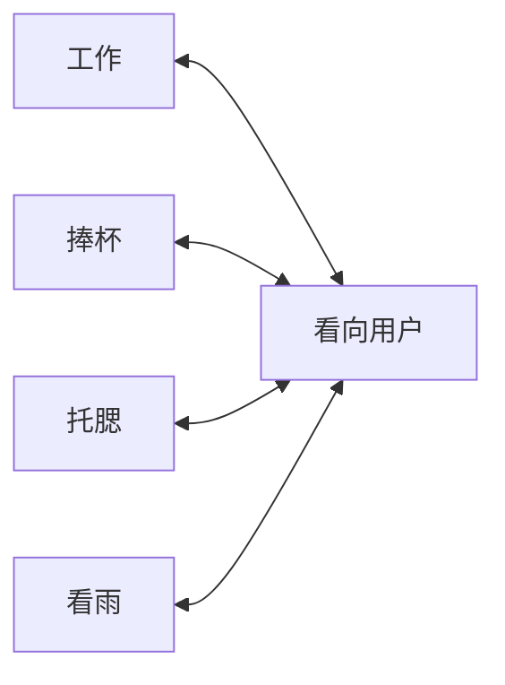

# 保留五姿态的画面一致性与自然衔接方案

> 2026-10-24 更新：用户决定先做工作、望窗、看向用户三态，并稍后提供视频工具；本阶段先交付[三图六转场素材包](three-state-video-kit-2026-10-24.md)。下文五姿态及拿杯试验保留为后续参考，不是当前批次要求。

日期：2026-10-23。关联 ART-09。用户最新要求是保留工作、捧杯、托腮、看雨、看向用户全部五姿态，优先一致性与过渡自然，允许重新考虑视频。这撤销了“研究范围只能是静态图片”的限制，但不代表现有视频入口已经恢复，也不代表此前两次美术失败已解决。

本轮交付是有资料依据的制作与验证方案；未生成付费视频、安装/下载模型、替换主应用或承诺新美术通过。已有五张图与固定场景小样继续保留为参考及失败记录，不能直接作为合格首尾帧。

## 选择

**优先试验：保留五姿态、简化家具构图、固定4K场景，用短动作视频连接可长期停留的画面。** 素材在制作阶段完成合成；产品本地播放预制媒体。先检验一个拿杯/放杯闭环，失败就停止扩量并转入同一三维角色的资产方案评估。

| 路线 | 一致性与动作边界 | 决策 |
| --- | --- | --- |
| 独立生成五张整图，再叠化/插中间图 | 已出现家具几何漂移；叠化不提供真实拿杯或转头路径 | 不再作为主要制作路线 |
| 固定场景＋精确人物层＋短视频 | 可用同一背景，连续动作能承担过渡；仍有脸型、抠像、杯子和遮挡风险 | 作为有明确失败条件的小规模首选试验 |
| 同一三维场景＋同一绑定角色，离线渲染 | 家具和镜头可确定性固定，可直接输出透明人物及道具；角色还原、绑定、材质和动作需制作 | 需要可靠资产时的后备生产路线，不能宣称几行脚本还原原画 |

后两条路线的证据和反例见[三维与视频抠像核查](character-continuity-sources-2026-10-23.md)。固定背景只锁定透明区域；人物层若残留旧沙发仍会漂移，这一问题不会因换成视频自动消失。

## 构图和五种姿态

调整构图，不减少姿态：雨夜窗景集中左侧，人物在右侧；保留现有人物、红衬衫和半写实氛围。采用桌前中近景，桌面遮住腰腿，去掉出镜的厚扶手；靠背尽量隐在躯干后。人物附近背景改为简单、低对比的墙面/窗帘，减少头发与家具交错。桌面上杯子的唯一落点、电脑位置、相机和光源均固定。

| 姿态 | 动作设定 | 必须保持的接触与道具状态 |
| --- | --- | --- |
| 工作 | 略向电脑前倾，头肩朝屏幕，手处于键盘位置 | 电脑及键盘固定，手不穿透桌面 |
| 捧杯 | 双手拿杯至胸前自然停留 | 杯子从固定落点拿起，放回同一位置；同一时刻只有一只杯子 |
| 托腮 | 肘部在桌面支撑，下巴轻靠手 | 肘、腕、下巴位置合理，不新增支撑物 |
| 看雨 | 头肩协调转向左侧雨窗 | 坐姿落点和桌椅不移动，眼睛确实看向窗外 |
| 看向用户 | 头肩自然转向用户，双手放松于桌面附近 | 作为共同中性姿态，杯子在桌面；不是换一张脸 |

动作通过头肩朝向及手臂姿态区分。每种都需在普通桌面显示尺寸可辨认，不靠单独改变表情冒充新动作。

## 制作顺序与验证门槛

### G0：固定场景与人物母版

先制作一张中性陪伴母版，锁定坐姿、脸型、发饰、衣领、肩宽、桌沿和杯子落点。背景与前景家具只制作一次。人物、杯子、桌沿及遮挡关系分别管理；生成图只能提供候选，不能作为像素锁定机制。

首轮不扩展五张独立姿态，不把旧沙发小样换个模糊参数继续当作底板。完整检查人物层在棋盘格/明暗底色上的轮廓和孔洞，背景冻结后再进入视频试验。

### G1：最难的拿杯闭环

测试镜头为“看向用户 → 伸手拿杯 → 双手捧杯停留 → 放杯 → 看向用户”，固定单镜头，建议总长8–10秒，动作两端及捧杯处有安静停留。时间安排是制作目标，不是已验收参数。返回动作在同一条真实动作时间线内完成，不把拿杯过程倒放当作放杯。

先审原始视频是否有脸型变化、手指错误、杯柄变化、身体尺度变化或机位移动，再尝试分离人物与杯子、合入固定背景。原始人体错误不能由抠像修复。SAM/RVM等可辅助选区，但手指孔洞、杯柄、发丝、边缘旧背景颜色和接触阴影都需独立复核。

使用最多两种候选模型，每种先做一条，针对明确失败原因最多各修订一次。这是控制试验范围的建议，尚无付费额度或账户授权，不执行无限重抽。出现家具残片、手杯穿插或明显身份漂移则该候选失败；若受控修订仍不能通过，不开始剩余姿态的批量生产。

### G2：从同一最终时间线导出静帧与动作

通过原始动作和分层检查后，统一处理画幅、色彩、分辨率和编码，再从最终时间线的稳定帧导出停留图片。停留图与进入/离开动作使用同一帧来源；不分别美化静图和视频，以免停下时突然变清晰、变脸或改衣褶。

首尾帧输入是生成条件，不是输出逐像素等于输入的保证。跨片段接缝仍要检查，不能强行插入一张原首帧掩盖不匹配。桌沿和所有可见家具轮廓固定；人物移动引起的正常遮挡或局部阴影变化与几何漂移分开验收。

验证包含：实际4K下整幅来回播放；脸、双手、杯柄和桌沿100%局部检查；至少十次停留/进入/返回的接缝检查。全幅差异与独立检查的透明层共同定位异常，不能沿用9个固定矩形作为完成证据。

### G3：扩展五态，再接入应用

捧杯闭环通过后制作工作、托腮、看雨与中性陪伴之间的动作。五姿态是完整交付目标；只做两态试验是验收顺序，不是删减目标。长期停留优先使用静帧；轻呼吸/眨眼短循环属于后续增强，不是首轮的额外验收负担。

4K指最终输出画布和实看细节验收。低分辨率视频放大后必须标为超分；不能仅凭3840像素文件宣称原生4K。沿用3840×2400画布及16:9安全区；视频通道若只提供16:9，制作时统一构图/补边方案，禁止拉伸人物或让各片段独立中心裁切。

## 模型与实际接入状态

本项目首轮建议对照 **MiniMax H3首尾帧模式** 与 **Seedance 2.5首尾帧模式**，使用同一母版、同一拿杯闭环目标、各自支持的原生设置。H3官方分开提供FL2VA首尾帧与Ref2VA多模态参考，不应把两种模式混为一谈；官方公开Base和完整高分辨率服务也不同。[H3作者仓库](https://github.com/MiniMax-AI/MiniMax-H3)

Runway官方模型目录及SDK列有H3、Seedance 2.5；SDK支持两者的首尾帧模式。目录也列有Kling 3.0 4K，SDK列出3840×2160及首尾帧输入，可在动作质量通过后核查是否适合作为高分辨率交付对照。这些接口事实不构成三者画质排名，也不证明聊天插件暴露了相同字段。[模型目录](https://docs.dev.runwayml.com/guides/models/)、[官方SDK](https://github.com/runwayml/sdk-node/blob/main/src/resources/image-to-video.ts)

2026-10-23插件发现结果：Runway可添加但当前未安装/连接，已提供添加建议。当前内置工具能生成图片，未发现已连接的可直接生成这些视频的工具。因此完成方案不等于已经能调用付费视频生成；下一阶段需实际连接并核查模型、首尾帧参数和账户额度，或使用用户提供的成片。不得伪称已调用成功。

本地Wan首尾帧能力有Comfy官方工作流支持，可保留为制作侧备选；本轮不恢复下载或安装，另一台5060Ti 16GB电脑也未做性能实测。制作算力与日常应用播放要求应分开讨论。[Comfy官方首尾帧工作流](https://docs.comfy.org/tutorials/video/wan/wan2_2)

## 应用播放与现有功能

建议以“看向用户”的中性姿态为共同衔接点，连接其余四姿态，首版需要8条有向动作，而非五态两两都制作20条：

每条进入与退出都来自实际制作的动作，不能机械倒放。空闲状态之间通过中性姿态连接，并控制停留节奏；这会带来一次中性停留，是明确的素材数量/行为取舍。

用户呼出对话或开始采音时，界面和音频立即响应；视觉在当前动作最近的安全停留点转向用户，目标为开始回应动作无需等待一整个长循环。可测的目标是预载后1秒内开始回应动作，拿杯等不可随意截断的动作若达不到，应补安全出口或调整动作长度，不能拖延采音或冻结界面。这个目标尚未验证。

现有 `prototypes/video-companion/player.mjs` 的双缓冲、解码后交接、暂停、取消过时加载、失败保图/重试机制可作为复用基础；当前版本仍是独立scene选择与loop区间，尚不支持上述姿态转场图、静帧混合停留或动作安全出口，需要单独实现。生产素材由应用自己的协议读取，运行不依赖Steam/Wallpaper Engine，也不需要本地运行生成模型。

两人物选择、人物默认声线提交、语音播报/采音、工作台、遥控焦点及环境音门禁继续沿用。姿态变化不重设声线，过渡视频静音；键盘声仅在工作状态，雨声连续，采音静音及朗读降音规则保留。失败保持最近有效画面、显示重试，恢复后状态需同步；FIX-17是重新集成前需处理的已有问题。

素材小样通过后再进行新的离线与Electron验证、真实语音/遥控试用。历史视频试用通过不能替代本方案的验证。

## 试验失败后的路线

若问题集中在可局部修整的透明边缘，可做定点修整并重验；若涉及持续的身份/肢体/道具接触错误，应停止这条生成流程。

此时转为同一三维人物、服装、头发、桌椅和杯子的离线制作：固定相机，骨骼控制五姿态，手杯接触明确绑定，导出静帧和动作视频后由原应用播放。家具几何因此由同一资产确定，但脸型还原、头发服装、绑定权重和动画仍需合格美术资产及修整。先验人物外观与拿杯闭环，不能用粗糙通用人偶替代用户要求，也不能承诺纯脚本自动达到现有画风。相关依据见上面的三维核查。

这一路线的投入应在看到角色资产样例后再评估；本轮没有给出没有依据的工期、成本或成功率。当前明确交付顺序为：母版 → 拿杯闭环 → 五姿态及衔接 → 主应用回归 → 用户画质/设备验收。
